# When Treasury bill auctions miss their targets

**Bid volumes, allotments and maturity shifts in Uganda, Kenya and Ghana using 1,210 event records reconstructed from central bank notices.**

**Omoding Isaac**¹ and **Kakande Alex**²

¹ Data Scientist, Ministry of Health · [omodingisaac111@gmail.com](mailto:omodingisaac111@gmail.com) · [GitHub](https://github.com/Isaac25-lgtm)  
² Financial Advisor · [Substack](https://kakandealex.substack.com)


Every week or fortnight, the Bank of Uganda, the Central Bank of Kenya and the Bank of Ghana sell Treasury bills. They announce how much they want to borrow, investors bid, and the central bank decides how much to accept. When the amount accepted falls short of the amount offered, commentary usually stops at one word: **undersubscribed**.

That word hides two very different events. **Either investors did not bid enough, or they bid enough and the issuer did not accept it.** We split every shortfall into those two parts, auction by auction and maturity by maturity, using only the notices the central banks publish. Between January 2023 and October 2026:

- **In Uganda, none of the shortfall volume came from a lack of bids.** All 34 auctions that fell short had bids at least equal to the offer.
- **In Kenya, 81.1% did,** and **in Ghana, 74.5%** (falling to 49% in 2026).
- **A filled total hides a lot:** 88% of Ugandan and 85% of Kenyan auctions that met their overall target still missed at least one maturity, which changes when the new debt falls due.

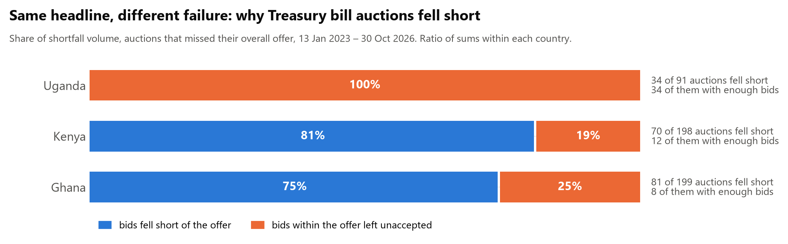

> **Read this first.** This is an accounting decomposition of published totals. It is not a causal account of why bids were rejected or why investors stayed away: the notices do not say, and aggregate bids include bids at every price. It has not been peer reviewed. Nothing here is investment advice. The central banks' openness in publishing every notice is what made this work possible.

## 1. The problem

For one auction (or one maturity within it), let $O$ be the amount offered, $B$ the gross bids tendered and $A$ the amount accepted, all at face value. The shortfall splits exactly into two parts:

$$
S=\max(O-A,\,0)\;=\;\underbrace{\max(O-B,\,0)}_{D:\ \text{bids short of the offer}}\;+\;\underbrace{\max\big(\min(O,B)-A,\,0\big)}_{R:\ \text{enough bids, not accepted}}
$$

The identity $S=D+R$ holds whenever $A\le B$. Across a set of auctions, the **volume share** $\sum D/\sum S$ says how much of the money that went unraised was missing because investors did not bid it. It is a ratio of sums within one currency, never a mean of ratios and never pooled across countries.

Two more distinctions matter:

1. **Auction-wide versus by maturity.** Summing $O$, $B$ and $A$ over the 91-, 182- and 364-day bills first can hide misses, because an over-filled long bill offsets an under-filled short one.
2. **The maturity of new debt.** The face-value-weighted maturity of what was accepted, $\sum A_j d_j/\sum A_j$, can differ from the offered mix, $\sum O_j d_j/\sum O_j$, even when the total is met. The primary comparison uses offers printed in results notices.

A third, smaller trap: the published **"bid to cover" ratio** is sometimes bids ÷ accepted and sometimes bids ÷ offered.

## 2. The research gap

| Strand | What it establishes | What it leaves open |
|---|---|---|
| IMF staff analysis of Uganda's yield curve [[1]](#ref-1) | Since the pandemic, monthly sold-to-offer ratios diverged: bonds undersold (≈ 0.9), bills oversold (≈ 1.1). Read as more active allocation management | No split of shortfalls into missing bids versus rejected bids, nothing per auction or per maturity, no maturity mix, no other countries |
| Machine-learning forecasts of Kenyan bill yields [[2]](#ref-2) | Ensembles can track the 364-day yield | Targets prices, not whether auctions raise what they planned |
| Determinants of bid-to-cover in deep markets [[3]](#ref-3) [[4]](#ref-4) [[5]](#ref-5) [[8]](#ref-8) | Cover ratios and auction tails respond to market conditions and offer size | Bidder-level or price data in the US, euro area and Canada; not the accounting question in frontier bill markets |
| Bidder behaviour [[6]](#ref-6) [[7]](#ref-7) | Bid shading and participation need bid-level data | Explains why aggregate data cannot answer behavioural questions |

**The gap we address:** we found no study that splits Treasury bill auction shortfalls into missing bids and unaccepted bids, per auction and per maturity, on audited official notices across several markets, and measures what the accepted mix does to the maturity of new debt. The literature search was not systematic ([matrix](docs/literature_matrix.md)), so this is a defensible gap, not a claim of priority. The IMF chapter is cited for the divergence it documents; we do not claim that discovery.

**What this study adds:**

1. An exact, auditable decomposition of every shortfall into missing bids and unaccepted bids.
2. Evidence that filled totals routinely hide maturity-level misses and shift the maturity of new debt.
3. An audit of what the published cover ratio actually divides by.
4. A historical forecasting evaluation using dated proxies for when information became public.
5. A reusable, open pipeline that rebuilds the panel from the central banks' archives.

## 3. How we investigate it

### Data

All discovery and downloads were frozen on **6 November 2026**. We discovered every document listed by the Bank of Uganda's auction API, the Central Bank of Kenya's results index and the Bank of Ghana's tender archive, recorded each file's SHA-256 hash, and classified documents **by their content, not their archive title**. The Bank of Uganda "results" folder also contains bond results and price matrices.

| | Uganda | Kenya | Ghana |
|---|---|---|---|
| Notices | Results + invitations to tender | Weekly results notice (results, then next week's offer) | Weekly tender notice (results, previous totals, next target) |
| Event records | 227 (Jan 2017 – Nov 2026) | 536 (Sep 2014 – Nov 2026) | 447 (Jan 2018 – Oct 2026) |
| Full-period auction-wide sample | 227 | 495 | 447 |
| Offer published | per maturity | per maturity | **combined only**, so Ghana is analysed auction-wide |
| Unit | UGX billions | KES millions | GHS millions |

Text was read from the PDF text layer, from Word table XML, or, for 2026 Ugandan releases whose table is an image, by OCR of the rendered page. Parsers keep the raw source line for every value and **refuse to guess**: a malformed number blocks the document until a reviewed correction exists.

### Estimands

| Estimand | Definition | Window |
|---|---|---|
| Volume share (**primary**) | $\sum D/\sum S$ over auctions that missed their offer | Common window 13 Jan 2023 – 30 Oct 2026 |
| Frequency | Number of misses with $B\ge O$ | Same |
| Masking | Auctions meeting the total but missing ≥ 1 maturity | Same |
| Maturity shift | Accepted minus offered weighted maturity, auctions that met the total | Same, plus 2025–26 and full series |

Intervals come from a moving-block bootstrap over time-ordered auctions (blocks of 4, 8 and 13 auctions; 2,000 replicates), keeping an auction's maturities together. The [protocol](docs/protocol.md) was frozen and committed before results were computed; every deviation is dated there.

### Forecasting design

Forecasts use the preceding weekday before the recorded bid-date proxy. Results enter from the weekday after their date-only release proxy. Models are refitted monthly, and models and simple rules can use newly public results at each origin. We use 2020–22 to select a baseline, 2023–24 as a historical holdout outside the pilot's scored period, and 2025–26 as a previously inspected comparison. The alert threshold targets a nominal 25% rate, and actual rates vary across models and periods.

## 4. The evidence, as a story

### Step 1. Rebuild the auctions from the source

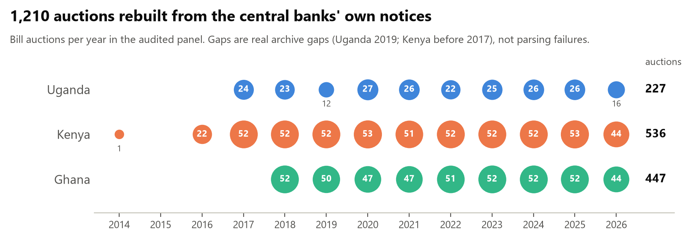

Kenya has 51–53 event records per full year from 2017. Some notices enter the tenor analysis only. Ghana's auction-wide sample includes valid two-tenor tenders and excludes seven unavailable and seven scope-blocked notices. Uganda's archive is missing 13 numbered results in 2019. Two common-window invitations have no matched results.

### Step 2. One auction shows the problem

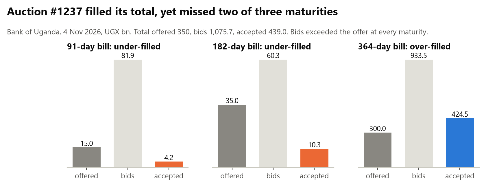

On 4 November 2026 the Bank of Uganda offered UGX 350 bn and accepted UGX 439 bn: **over-filled**. Yet the 91-day bill sold UGX 4.2 bn of 15 bn and the 182-day bill 10.3 bn of 35 bn, even though bids exceeded the offer for both. The 364-day bill took UGX 124.5 bn more than planned, so the new debt came out **23 days longer** than advertised.

### Step 3. The split differs sharply by country, and holds within maturities

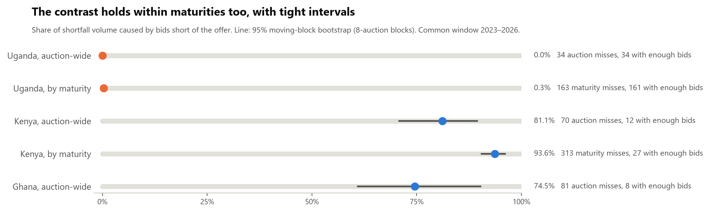

In Uganda, 161 of 163 maturity-level misses happened with bids at least equal to the offer. In Kenya, 286 of 313 happened because bids did not reach the offer. The contrast survives 5% and 10% materiality thresholds, pre-auction announced offers instead of published ones, excluding OCR-read rows, excluding auctions with offer discrepancies, and dropping any single year. About 32 unobserved, fully volume-driven auctions would be needed to lift Uganda's share to 50%; the archive is missing two.

### Step 4. The pattern changes over time

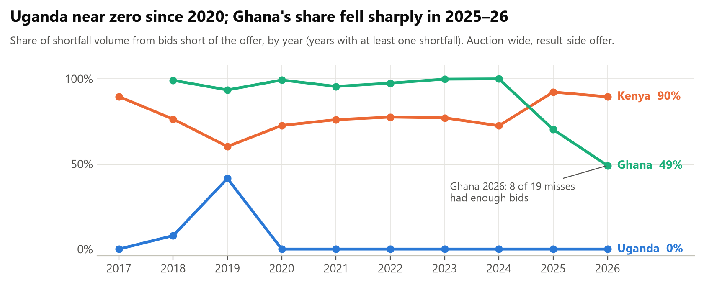

Uganda's few pre-2020 shortfalls were partly volume-driven; since 2020 none are. Ghana's shortfalls were almost entirely volume-driven until 2024. In 2026, 8 of its 19 shortfalls happened with enough bids on the table. A single average over the decade would hide this shift.

### Step 5. Filled totals hide maturity misses

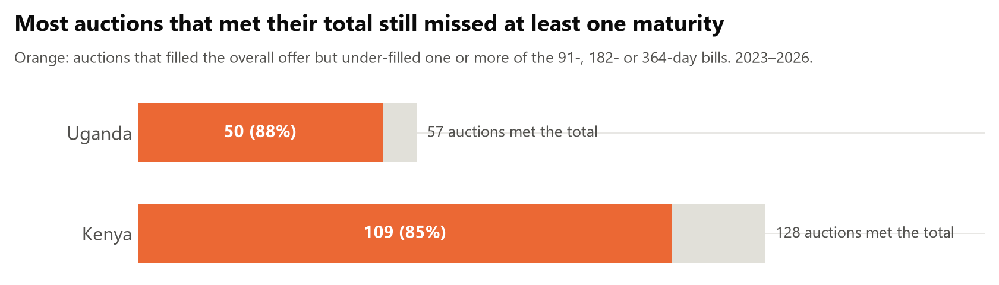

### Step 6. The maturity of new debt drifts, in opposite directions

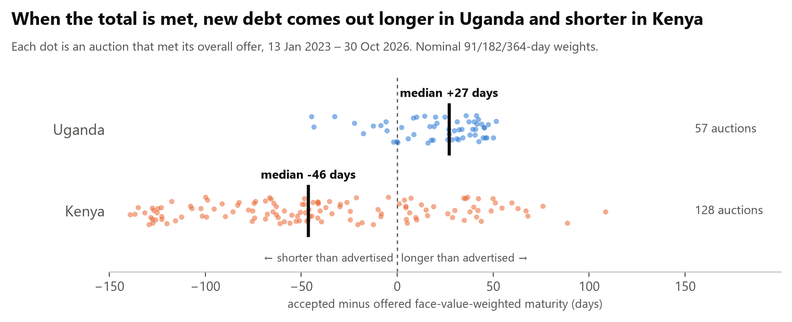

When the result-side total was met, Uganda accepted a mix **27 days longer** than offered (median, 364-day share +13.6 points), rising to 40 days in 2025–26. Kenya accepted a mix **46 days shorter** (364-day share −13.7 points), easing to 17 days in 2025–26. The matched announced-offer comparison gives +29.1 and −46.4 days in the common window. These shifts measure the face-value maturity of each auction's issuance.

### Step 7. Even the headline ratio changes meaning

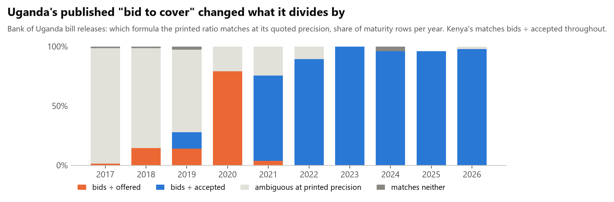

Uganda's printed "bid to cover" matched bids ÷ offered in most 2020 releases and usually matched bids ÷ accepted from 2021. The formulas coincide when accepted equals offered, and printed rounding can also make them indistinguishable. Kenya's identifiable published ratios match bids ÷ accepted. A high published ratio can therefore sit alongside a low fill.

### Step 8. Forecast performance across periods

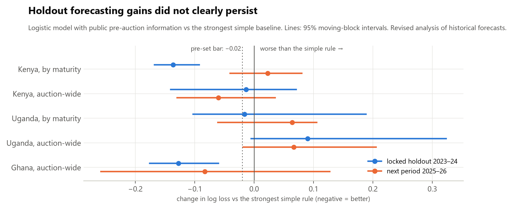

In 2023–24, the full logistic model reduced log loss by 0.137 nats for Kenyan maturity outcomes and 0.127 nats for Ghana auction outcomes. At equal retrospective alert rates, it captured 52.2% versus 49.9% of volume in Kenya and 57.4% versus 55.6% in Ghana. The later-period log-loss intervals crossed zero in both cases. A one-weekday delay in information availability leaves that pattern intact. These historical comparisons provide insufficient evidence for operational alerts.

### Step 9. Why you can trust the numbers

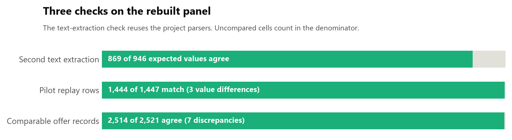

A second text-extraction pass reuses the project parsers and counts expected, compared and agreeing cells. The offer audit finds five amount discrepancies and two Ghana scope discrepancies. One Ghana announcement amount is unparseable. Where a Ghana results table and the next week's summary disagree, the results table is kept. Substituting the summaries for all six amount discrepancies leaves Ghana's shares unchanged ([T5b](outputs/tables/T5b_ghana_source_sensitivity.csv); decisions in [`data/review/ghana_source_decisions.csv`](data/review/ghana_source_decisions.csv)). See the [source audit](docs/audit_and_limitations.md) for the country denominators and remaining source questions.

## 5. How much weight each finding can carry

| Finding | Evidence | Strength |
|---|---|---|
| Uganda's shortfalls are not caused by missing bids (2023–26) | 34 of 34 auction misses with $B\ge O$; 0.0% share; robust to every check | **Strong**, pre-specified |
| Kenya's and Ghana's shortfall volume mostly reflects insufficient bids | 81.1% (70.8–89.5) and 74.5% (61.0–90.2) | Robust across the reported measurement sensitivities |
| Filled totals hide maturity misses | 88% Uganda, 85% Kenya | **Strong**, descriptive |
| Accepted mix longer in Uganda, shorter in Kenya | Medians +26.9 and −46.4 days; smaller over the full decade | Moderate, era-dependent |
| Ghana's split is changing | 49% in 2026, 8 of 19 misses with enough bids | Moderate, recent |
| Published cover ratio changed definition (Uganda) | Formula match by year at quoted precision | **Deterministic** |
| Operational forecasting | Historical gains vary across periods and alert rules | Insufficient evidence for deployment |

## 6. Validity checks and limitations

**Checks built in to challenge the findings:**

- **Second extraction:** see A5 for agreement, expected coverage, date checks and parser failures.
- **Reproduction:** the frozen source command verifies manifest hashes before parsing. The derived-data rebuild is available to reviewers without the source cache.
- **Robustness:** materiality thresholds, announced offers, OCR exclusion, offer-mismatch exclusion, leave-one-year-out.
- **Missing-auction stress test:** if the two missing Uganda auctions used the invitation amounts and attracted zero bids, the common-window share would rise to 21.7%.
- **Protocol:** the versioned pre-analysis plan predates the first rebuilt results commit. The revised run and its changes are documented separately.

**Limitations:**

- Accounting only. Without bid books we cannot say whether rejected bids were "too expensive", or why investors stayed away.
- Archive gaps: Uganda 2019, Kenya before 2017, seven Ghana files that no longer download. Ghana publishes only a combined target.
- Publication and bid-close dates are proxies in parts of the panel. The weekday calendar does not incorporate market holidays.
- Face values only: no cash raised, cost or fiscal simulation.
- Three markets and these years cannot establish how common these patterns are across Africa.
- Two Ghana values printed with a misplaced separator were corrected from the following week's totals; the lead author signed off both corrections ([`data/review/corrections.csv`](data/review/corrections.csv)).

## 7. If you publish or read auction results

A public auction report that lets readers tell two "undersubscribed" auctions apart would show, for each auction:

| Report | Why |
|---|---|
| Offer, bids and accepted amount **per maturity**, plus totals | Totals hide maturity misses |
| The shortfall split: **bids short of the offer** vs **bids not accepted** | They are different problems with different remedies |
| **Advertised vs accepted** weighted maturity | Shows how the issue changed the repayment profile |
| The **cover-ratio formula**, kept constant | Bids ÷ offered and bids ÷ accepted answer different questions |
| Any **revision** to the announced offer, with its date | Keeps pre-auction information honest |

A one-page version for debt managers is in the [policy brief](manuscript/policy_brief.md).

## 8. Pipeline and reproduction

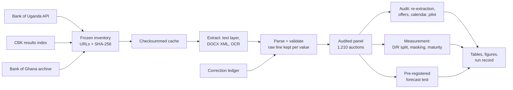

```bash
git clone https://github.com/Isaac25-lgtm/africa-treasury-bill-auctions.git
cd africa-treasury-bill-auctions
python -m venv .venv
# Windows:        .venv\Scripts\activate
# Linux / macOS:  source .venv/bin/activate
pip install -r requirements-lock.txt
pip install -e . --no-deps

pytest -q                                      # tests (no network needed)
python -m treasury_auctions fixtures           # end-to-end run on test fixtures
python -m treasury_auctions rebuild-outputs         # from the released derived tables and audit files
python -m treasury_auctions --frozen build          # recover exact manifest bytes and rebuild
python -m treasury_auctions --offline --frozen build # same rebuild from an existing exact cache
python -m treasury_auctions --publication-delay-weekdays 1 evaluate
```

Use `inventory` and `fetch` in a separate copy when deliberately creating a new vintage. The frozen build stops if any previously fetched bytes are unavailable or fail the recorded hash. Requires Python 3.11 or 3.12. Verified on Windows 11 with Python 3.12.10 and the locked dependencies. On Linux, OpenCV needs `libgl1 libglib2.0-0`.

| Path | Contents |
|---|---|
| [`outputs/reports/decision_memo.md`](outputs/reports/decision_memo.md) | **Start here:** verdict, evidence by gate, open items |
| [`manuscript/manuscript_draft.md`](manuscript/manuscript_draft.md) | Manuscript draft |
| [`manuscript/policy_brief.md`](manuscript/policy_brief.md) | Policy brief for debt managers |
| [`docs/protocol.md`](docs/protocol.md) | Pre-analysis protocol and deviations log |
| [`docs/audit_and_limitations.md`](docs/audit_and_limitations.md) | Source audit, coverage, limitations |
| [`docs/data_dictionary.md`](docs/data_dictionary.md), [`docs/data_provenance.md`](docs/data_provenance.md) | Every column; sources, freeze and rights |
| [`docs/literature_matrix.md`](docs/literature_matrix.md) | Closest work and what was verified |
| [`data/derived/`](data/derived) | Audited panel with source URL, hash and raw text per value |
| [`data/frozen/`](data/frozen), [`data/review/`](data/review) | Source inventories and hashes; correction ledger |
| [`outputs/tables/`](outputs/tables), [`outputs/figures/`](outputs/figures) | All results; publication figures with source data |
| [`src/treasury_auctions/`](src/treasury_auctions), [`tests/`](tests) | Pipeline and test suite |
| [`pilot_reference/`](pilot_reference/REPLAY_README.md) | The earlier exploratory pilot, kept for comparison |

## 9. Data and credits

### Data sources

| Source | Role | Coverage | Access |
|---|---|---|---|
| [Bank of Uganda](https://bou.or.ug/financial_market) | Treasury bill results and invitations to tender | 227 auctions, 2017–2026 | Public website and auction API |
| [Central Bank of Kenya](https://www.centralbank.go.ke/bills-bonds/treasury-bills/) | Weekly Treasury bill results notices | 536 auctions, 2014–2026 | Public website |
| [Bank of Ghana](https://www.bog.gov.gh/gog_auction_results/) | Weekly tender result notices | 447 tenders, 2018–2026 | Public website and archive API |

### Data handling

- **Source documents are not redistributed.** The repository holds their URLs and SHA-256 hashes plus a workflow that downloads them from the issuers.
- **Every value is traceable** to its document, hash and the raw line of text it came from.
- **Downloads were polite:** a named research client, at most four connections, official hosts only, no login or bot check bypassed.
- **Derived tables** are factual extracts attributed to the issuing central banks; cite the original notices when reusing them.

### Credits

- **The Bank of Uganda, the Central Bank of Kenya and the Bank of Ghana** for publishing every auction notice openly.
- **Software:** Python, pandas, NumPy, scikit-learn, SciPy, Matplotlib, PyMuPDF, pdfplumber, RapidOCR. Full lock: [`requirements-lock.txt`](requirements-lock.txt).
- **AI assistance:** code and documents were developed with Claude Code (Anthropic) under the authors' direction. The authors are responsible for the content.

Code is released under the [MIT licence](LICENSE). The licence does not cover the source documents.

## 10. Authors

| Author | Role and affiliation | Contact |
|---|---|---|
| **Omoding Isaac** (lead and corresponding author) | Data Scientist, Ministry of Health. Study design, data engineering, statistical analysis and reproducibility | [omodingisaac111@gmail.com](mailto:omodingisaac111@gmail.com) · [GitHub](https://github.com/Isaac25-lgtm) |
| **Kakande Alex** (co-author) | Financial Advisor. Market context, institutional interpretation and policy implications | [Substack](https://kakandealex.substack.com) |

The views expressed are the authors' own and do not represent any institution. Nothing here is investment advice. Contribution roles (CRediT) will be finalised before submission.

## 11. References

<a id="ref-1"></a>1. Qu H. Uganda's Government Bond Yield Curve: Structure, Drivers, and Policy Implications. In: *Uganda: Selected Issues*. IMF Country Report 26/216. International Monetary Fund; 2026:4-16. <https://doi.org/10.5089/9798229057196.002.A001>

<a id="ref-2"></a>2. Njeri KM, Anyika E, Hadullo K. Machine learning model for treasury bill yields prediction in Kenya. *Global Journal of Engineering and Technology Advances*. 2025;24(3):12-20. <https://doi.org/10.30574/gjeta.2025.24.3.0259>

<a id="ref-3"></a>3. Beetsma R, Giuliodori M, Hanson J, de Jong F. Determinants of the bid-to-cover ratio in Eurozone sovereign debt auctions. *Journal of Empirical Finance*. 2020;58:96-120. <https://doi.org/10.1016/j.jempfin.2020.05.005>

<a id="ref-4"></a>4. Tindall ML, Perez MA. Treasury auctions during the pandemic: stresses but few surprises. Federal Reserve Bank of Dallas; 31 August 2021. <https://www.dallasfed.org/research/economics/2021/0831>

<a id="ref-5"></a>5. Gao J, Epp A. Auction Timing Under Limited Information: Evidence from Sovereign Bond Auctions. Bank of Canada Staff Analytical Paper 2026-51; 2026. <https://doi.org/10.34989/sap-2026-51>

<a id="ref-6"></a>6. Hortaçsu A, Kastl J, Zhang A. Bid Shading and Bidder Surplus in the US Treasury Auction System. *American Economic Review*. 2018;108(1):147-169. <https://doi.org/10.1257/aer.20160675>

<a id="ref-7"></a>7. Allen J, Hortaçsu A, Richert E, Wittwer M. Entry and Exit in Treasury Auctions. NBER Working Paper 34646; 2026. <https://doi.org/10.3386/w34646>

<a id="ref-8"></a>8. U.S. Government Accountability Office. Federal Debt Management: Treasury Is Meeting Borrowing Needs but the Deteriorating Fiscal Outlook Poses Risks. GAO-26-107529; 2026. <https://files.gao.gov/reports/GAO-26-107529/index.html>
